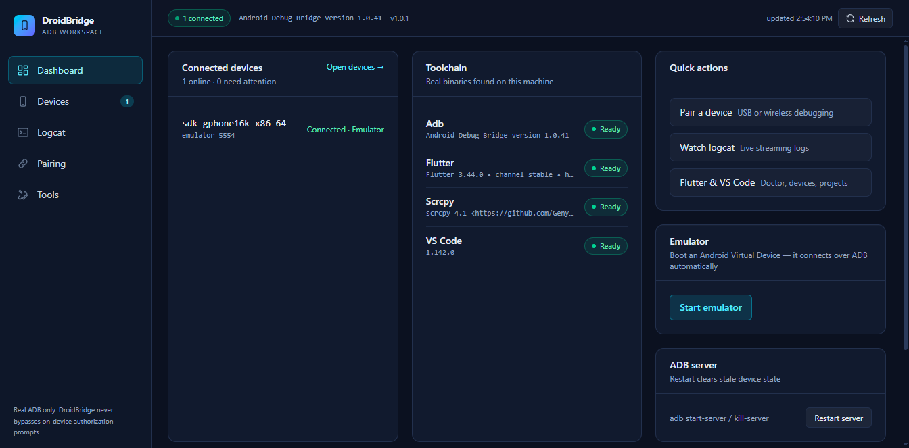
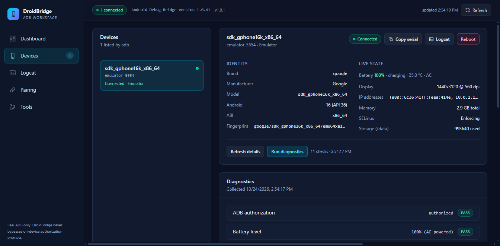
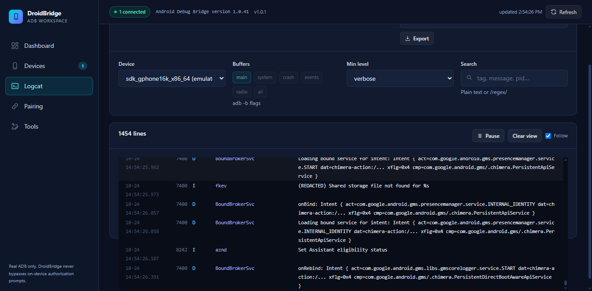
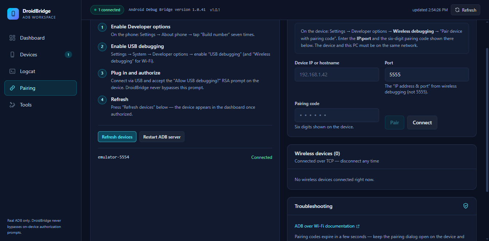
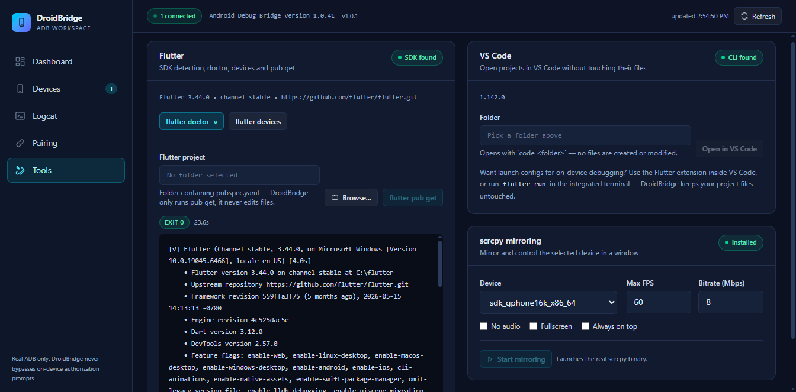

# DroidBridge

A Windows x64 developer dashboard for Android devices — built with **Electron, React, TypeScript and Tailwind CSS**. DroidBridge detects devices over **USB and authorized wireless ADB**, streams **logcat**, runs **device diagnostics**, guides you through **pairing**, integrates with **Flutter** and **VS Code**, and can mirror screens with **scrcpy**.

Everything you see is real: DroidBridge shells out to the actual `adb`, `flutter`, `scrcpy` and `code` binaries. It never fabricates device data, never bypasses Android's on-device authorization prompt, and never builds shell command strings from user input.

---

## Features

| Area | What you get |
| --- | --- |
| **Dashboard** | Live device list, toolchain health (adb / Flutter / scrcpy / VS Code with paths + versions), **auto-install of missing adb & scrcpy** (official zips, one click for the rest), **start an Android emulator** (AVD picker), quick actions, ADB server restart |
| **Devices** | Per-device inspector: identity props, battery, display, memory, storage, IPs, plus one-click **diagnostics** with pass/warn/fail checks and hints |
| **Logcat** | Multi-buffer live streaming (`-v threadtime`, `-b main/system/crash/…`), level + search/regex filters, pause/resume, clear (`logcat -c`), export to a file you choose |
| **Pairing** | Step-by-step **USB workflow** (developer options → USB debugging → authorize) and **wireless pairing** (`adb pair ip:port code`, `adb connect`, `adb disconnect`) |
| **Flutter** | SDK detection, `flutter doctor -v`, `flutter devices`, `flutter pub get` in a folder you pick (never modifies project files) |
| **VS Code** | CLI detection, open any project folder with `code <dir>` |
| **scrcpy** | Optional mirroring with fps/bitrate/audio/on-top/fullscreen options, launch & stop managed by DroidBridge |
| **Auto-updates** | Installed builds check GitHub Releases at launch and every 4 h, download in the background, then **Restart now** applies the update **silently — no setup wizard — and reopens the app** (or installs it on quit) |

## Screenshots

Real captures from the running app, taken against an Android 16 emulator — regenerate with
`node scripts/capture-screenshots.mjs` (needs the app running with a CDP port and a device or
emulator attached).

<table>
  <tr>
    <td align="center">
      <br />
      <sub><b>Dashboard</b> — live devices, toolchain health, emulator launcher, quick actions</sub>
    </td>
    <td align="center">
      <br />
      <sub><b>Devices</b> — identity, live state and one-click diagnostics with pass/fail checks</sub>
    </td>
  </tr>
  <tr>
    <td align="center">
      <br />
      <sub><b>Logcat</b> — live streaming with buffers, levels, search, pause and export</sub>
    </td>
    <td align="center">
      <br />
      <sub><b>Pairing</b> — guided USB authorization and wireless pairing flows</sub>
    </td>
  </tr>
  <tr>
    <td align="center" colspan="2">
      <br />
      <sub><b>Tools</b> — real <code>flutter doctor</code> output, VS Code integration and scrcpy mirroring options</sub>
    </td>
  </tr>
</table>

## Requirements

- Windows 10/11 x64 — that's it: **adb and scrcpy install automatically** on first launch (official Google / Genymobile downloads into `%LOCALAPPDATA%\DroidBridge\tools`, no admin rights) if they are missing.
- Already have them? They are used as-is: `adb` on `PATH`, in `%LOCALAPPDATA%\Android\Sdk\platform-tools`, via `ANDROID_HOME`, or set `DROIDBRIDGE_ADB_PATH`.
- Optional: [Flutter SDK](https://docs.flutter.dev/get-started/install) and VS Code — DroidBridge offers **one-click Install** buttons for both (silent `winget` installs; Flutter is multi-GB, so it never auto-downloads).

DroidBridge also honours these optional overrides: `DROIDBRIDGE_ADB_PATH`, `DROIDBRIDGE_FLUTTER_PATH`, `DROIDBRIDGE_SCRCPY_PATH`, `DROIDBRIDGE_VSCODE_PATH`, `DROIDBRIDGE_EMULATOR_PATH`.

## Install (prebuilt)

Run `release\DroidBridge-Setup-1.0.0-x64.exe` — a per-user NSIS installer with Start Menu and Desktop shortcuts. No admin rights required.

Installed copies stay current: DroidBridge checks the project's [GitHub Releases](https://github.com/Abdullah-584/droidbridge/releases) for a newer version, downloads it in the background and offers **Restart now** — the update then installs **silently in the background (no setup wizard)** and the new version reopens itself. Choosing **Later** installs it on quit.

## Develop

```bash
npm install
npm run dev        # esbuild watch (main + preload) + Vite dev server + Electron
```

## Verify

```bash
npm run typecheck  # strict TypeScript across main, preload, renderer and tests
npm test           # vitest: unit + integration tests (uses the real adb on your machine)
```

## Build

```bash
npm run build      # typecheck + bundle main/preload (esbuild) + renderer (Vite)
npm run dist       # everything above + NSIS x64 installer into release/
npm run dist:dir   # unpacked app directory only (fast local smoke test)
npm start          # run the built app (dist/) with Electron
```

## Architecture in one screen

```
┌────────────────────────── renderer (sandboxed) ──────────────────────────┐
│ React views  ←  lib/api.ts (typed call/subscribe)  ←  window.droidbridge │
└───────────────────────────────▲──────────────────────────────────────────┘
                                │ contextBridge (allow-listed channels only)
┌───────────────────────────────▼──────────────────────────────────────────┐
│ preload: validates channel names, wraps ipcRenderer.invoke                │
└───────────────────────────────▲──────────────────────────────────────────┘
┌───────────────────────────────▼──────────────────────────────────────────┐
│ main: ipc/registry (validate → handle → Result envelope)                 │
│   services/ (devices, pairing, tools, installer, scrcpy, emulator, …)   │
│   adb/ (locate, run: spawn without shell, parse, logcat streaming)       │
│   process/registry (tracks + kills every child process on quit)          │
└───────────────────────────────▲──────────────────────────────────────────┘
                                │ spawn(bin, argv, { shell: false })
                        adb.exe / flutter.bat / scrcpy.exe / code.cmd / emulator.exe
```

The full contract lives in [`src/shared/types.ts`](src/shared/types.ts) (one `IpcInvokeMap` shared by both sides) — see [docs/architecture.md](docs/architecture.md).

## Security posture

- **No shell, ever.** Every external command is `spawn(bin, argv, { shell: false })`. Batch wrappers (`.bat`/`.cmd`, e.g. Flutter) go through `cmd.exe` with strict quoting and a metacharacter denylist — see [docs/security.md](docs/security.md).
- **No authorization bypass.** `unauthorized` devices get guided instructions ("accept the RSA prompt"), never key tricks.
- **Hardened renderer.** `contextIsolation`, `sandbox`, no Node integration, strict CSP, navigation and popup blocking, permission denial.
- **Validated IPC.** Every invoke is schema-validated at the boundary; errors come back as structured results.
- **No project writes.** Folders are opened, never modified; the only file DroidBridge writes is the log you explicitly export.
- **Safe installs.** Auto-installed tools come only from fixed official HTTPS sources, are extracted without a shell, verified by running the installed binary, and live in a per-user directory — see [docs/security.md](docs/security.md).

## Documentation

- [docs/architecture.md](docs/architecture.md) — process model, IPC contract, module map
- [docs/security.md](docs/security.md) — threat model and the guarantees above in detail
- [docs/testing.md](docs/testing.md) — test layers and how to run each
- [docs/releasing.md](docs/releasing.md) — cutting the Windows x64 installer

## License

MIT — see [LICENSE](LICENSE).
